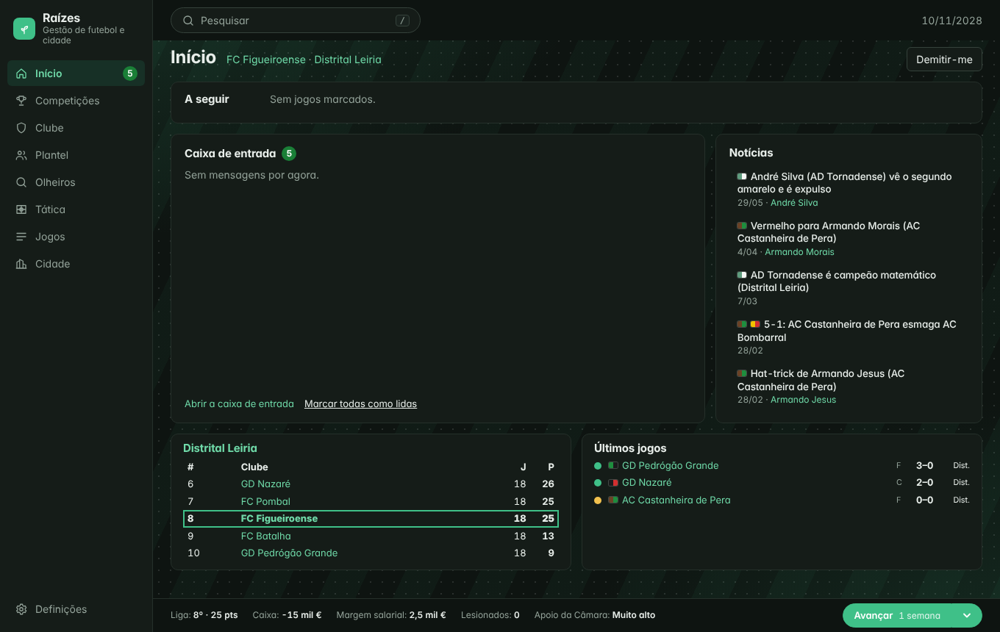
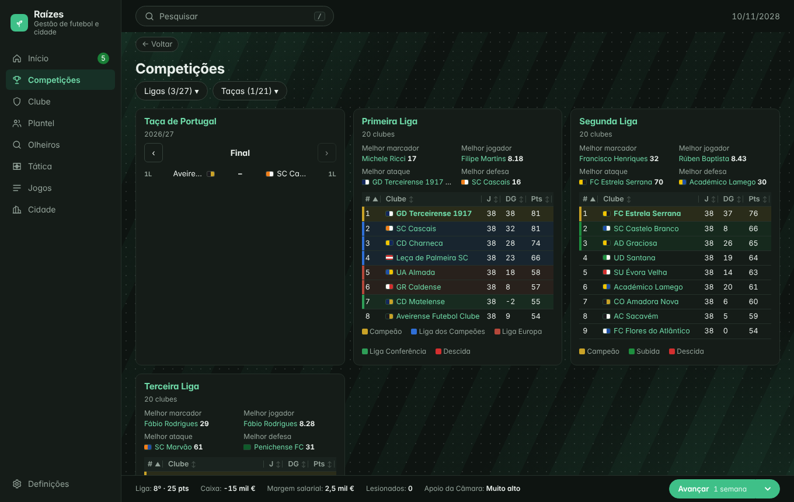
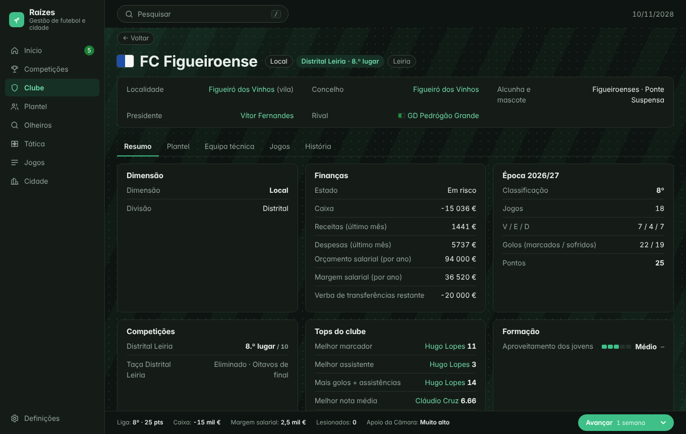
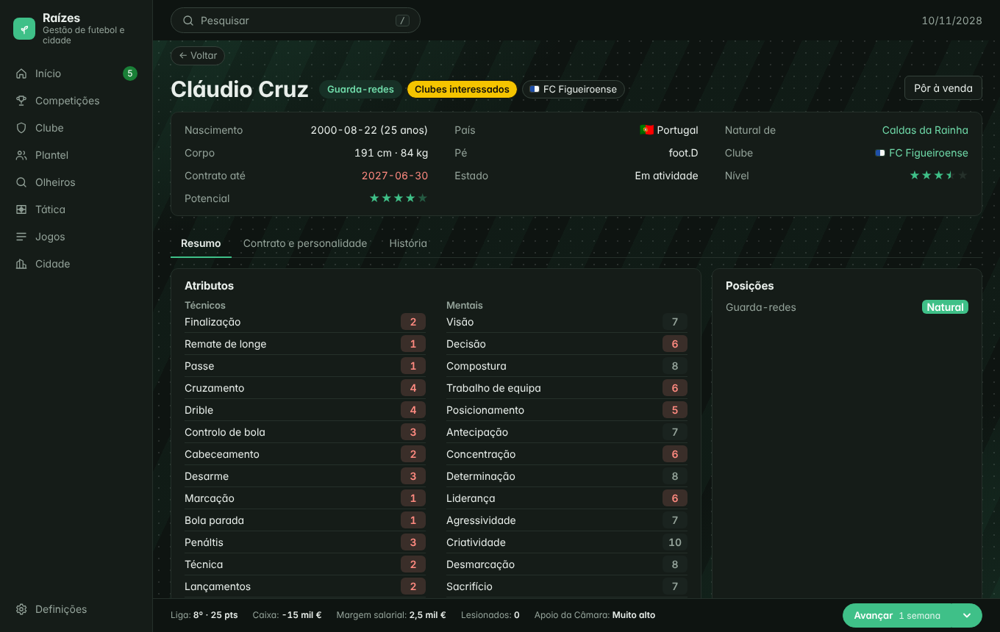
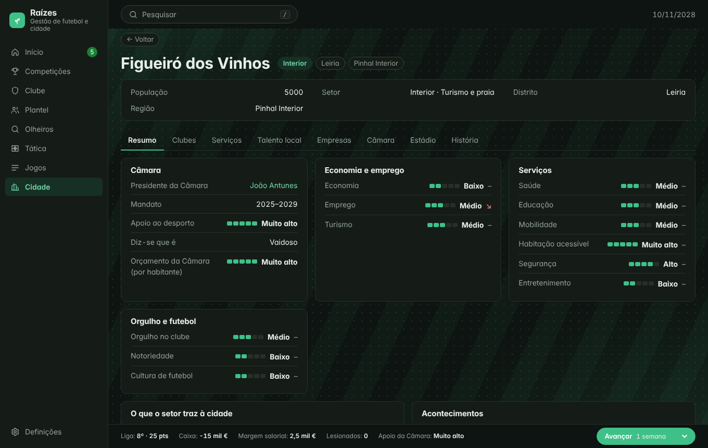
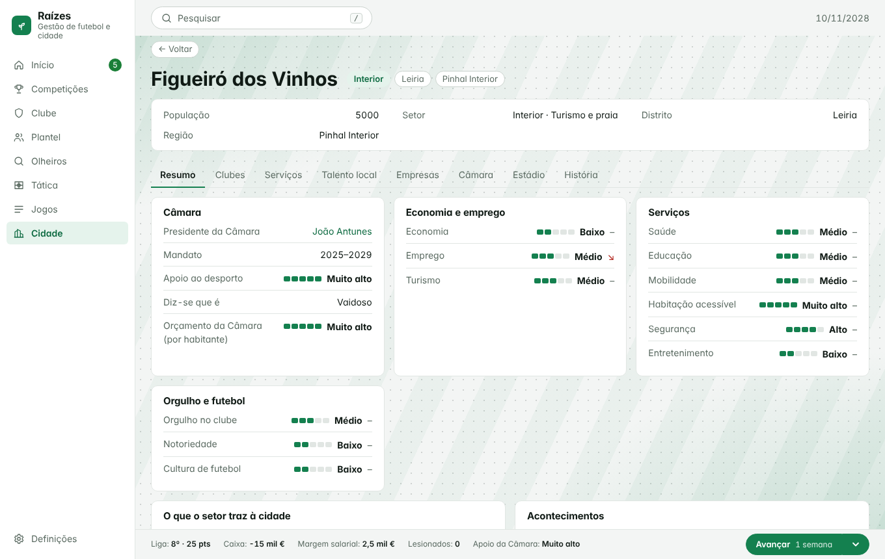

# Raízes

**Gestão de futebol português onde o clube e a terra crescem juntos.**

Começa numa distrital, com um clube pequeno de uma vila do interior, e tenta fazê-lo subir a pirâmide. Ao longo do caminho vais descobrir talento, negociar contratos, convencer a Câmara a apoiar-te e ver a cidade (e os adeptos) reagir a cada vitória. Um jogo de histórias, mais do que de folhas de cálculo.



## O que é

- **Clubes ligados a cidades.** 300 clubes fictícios espalhados por 276 concelhos, de Montalegre a Faro, passando pelas ilhas. A economia, a saúde, a educação, o orgulho local e o turismo da terra mexem com o clube, e o clube mexe com a terra.
- **A pirâmide inteira.** Primeira Liga, Segunda Liga, Terceira Liga, Campeonato de Portugal e 20 ligas distritais, com subidas, descidas, taças e competições europeias. Ninguém é figurante: tudo é simulado, mesmo longe do teu clube.
- **Descobrir talento.** Manda olheiros, observa jogadores semana a semana e vê as estrelas ficarem mais nítidas. Os jovens da tua terra são o teu maior trunfo, mas os clubes maiores também os querem.
- **Mercado a sério.** Propostas, contrapropostas, agentes, cláusulas, empréstimos, compensação de formação e jogadores com personalidade própria que podem recusar-te.
- **Uma cidade viva.** Serviços, emprego, turismo e orçamento da Câmara evoluem devagar e geram acontecimentos. A terra decide em parte quem quer lá viver e jogar.
- **Jogos ao vivo.** Os teus jogos decorrem minuto a minuto, com tática e substituições. Os restantes ficam com os golos, os vermelhos e o melhor em campo.
- **Notícias com tom de imprensa real.** Realistas, com ironia pontual.

|  |  |
|---|---|
|  |  |
|  |  |

Há também tema claro (e automático, conforme o sistema):



## Como jogar

O jogo corre no browser, sem conta nem servidor. Fica tudo guardado no teu navegador (SQLite) e o mundo é gerado de raiz para cada save, por isso nenhuma partida é igual a outra.

1. **Cria um mundo** (uma semente dá sempre o mesmo mundo) e escolhe o clube com que queres começar. Podes demitir-te mais tarde e aceitar propostas de outros clubes.
2. **Avança no tempo** com o botão *Avançar* (ou a barra de espaço): um dia, uma semana ou até ao próximo jogo. O jogo para sempre que precisa de ti: propostas por responder, jogos do teu clube, decisões.
3. **Gere o clube:** plantel, tática, olheiros, finanças e contratos. Em escalões baixos és o faz-tudo; ao crescer, delegas.
4. **Olha para a terra:** a ficha da cidade mostra serviços, economia, Câmara e talento local, com setas de tendência.

> Nota: o armazenamento do browser pode ser apagado (sobretudo no Safari). Exportar saves está previsto.

## Correr o projeto

Precisas de Node 24 (LTS, ver `.nvmrc`) ou superior e pnpm.

```bash
pnpm install
pnpm dev        # http://localhost:3000
```

Outros comandos: `pnpm test` (testes rápidos), `pnpm test:slow` (calibração e simulações de várias épocas), `pnpm typecheck`, `pnpm lint`, `pnpm build` (exportação estática para `out/`) e `pnpm run ci` (tudo o que corre na integração contínua).

## Por dentro

- **Motor em TypeScript puro** (`src/engine`), sem React nem DOM, a correr num Web Worker. Determinístico e testável sem interface: 50 épocas em segundos.
- **Histórico em SQLite** (WASM + OPFS no browser): um log de eventos que nunca se apaga, de onde se reconstrói tudo. O jogador só vê o que sabe: o que está oculto (personalidade, atributos, finanças dos outros) só se descobre observando.
- **Interface em Next.js** (exportação estática), em pt-PT e inglês.
- **Dados de base** em `data/` (clubes, concelhos, distritos, rivalidades), regeneráveis com `python3 tools/build_data.py`.

Estrutura: `src/engine/` (motor e regras, parâmetros em `config/parameters.ts`), `src/ui/` e `src/app/` (interface), `data/` (dados), `docs/` (desenho).

## Documentação

- [`BACKLOG.md`](BACKLOG.md): o que está feito, o que vem a seguir e as decisões tomadas.
- [`docs/DESIGN_RULES.md`](docs/DESIGN_RULES.md): pirâmide, prémio do Estado, distritais, sinergias.
- [`docs/CITY.md`](docs/CITY.md): a cidade e as suas ligações ao clube.
- [`docs/MARKET.md`](docs/MARKET.md), [`docs/PERSONALITY.md`](docs/PERSONALITY.md), [`docs/GAME_ENGINE.md`](docs/GAME_ENGINE.md), [`docs/EUROPE.md`](docs/EUROPE.md): mercado, personalidade, jogo e competições europeias.
- [`docs/TONE_AND_UX.md`](docs/TONE_AND_UX.md) e [`docs/UI_SYSTEM.md`](docs/UI_SYSTEM.md): tom das notícias e sistema de interface.

## Estado

Em desenvolvimento ativo (nome provisório). Todos os clubes e pessoas são fictícios, e o jogo não usa dados nem nomes de pessoas reais.
